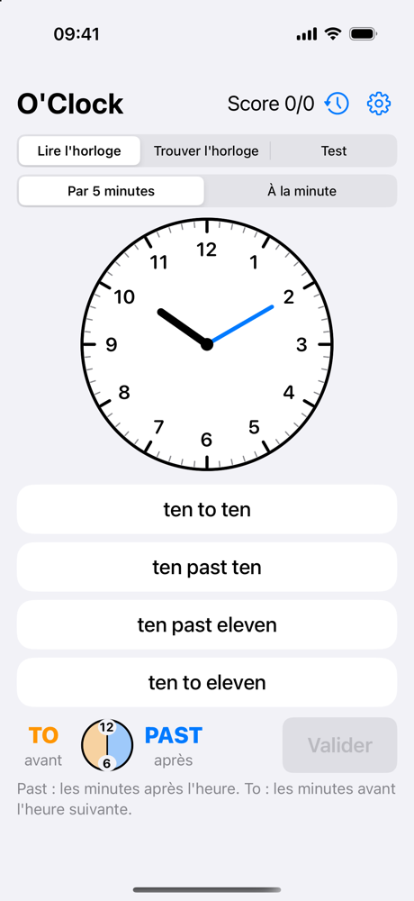
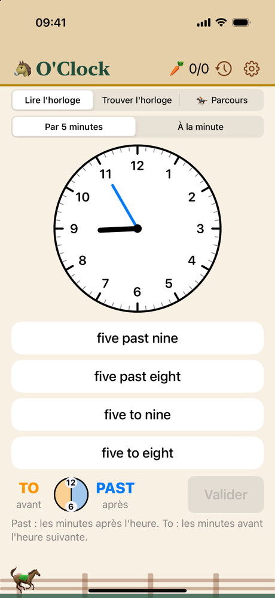

# O'Clock

Une petite app iPhone et iPad pour apprendre à **lire l'heure en anglais** : *five past nine*, *quarter to ten*, *twenty-five to three*…

<p align="center">
  
  &nbsp;&nbsp;
  
</p>

## Pourquoi cette app ?

J'ai fait O'Clock pour aider ma fille, en 6e, à réviser l'heure en anglais. La règle tient en une phrase : avant la demie on dit *past* (les minutes **après** l'heure), après la demie on dit *to* (les minutes **avant** l'heure suivante). Mais l'appliquer devant une horloge à aiguilles, c'est une autre histoire : on inverse *past* et *to*, on oublie de passer à l'heure suivante…

Plutôt que des fiches, je lui ai fabriqué un petit jeu qui pose la question, explique l'erreur en français et prononce la bonne réponse avec l'accent anglais. Je le partage ici en open source, au cas où il servirait à d'autres élèves, parents ou enseignants.

## Ce que fait l'app

- **Lire l'horloge** : une horloge à aiguilles, quatre phrases en anglais, une seule est juste.
- **Trouver l'horloge** : l'inverse, une phrase en anglais et quatre horloges.
- **Test** : 10 questions mélangées dans les deux sens, sans correction pendant le test et avec un bilan détaillé à la fin.
- **Deux niveaux** : par tranches de 5 minutes, ou à la minute près.
- **Des explications après chaque réponse**, en français : « La grande aiguille est à gauche du cadran : on dit to, pas past. »
- **Des pièges réalistes** : les mauvaises réponses reprennent les erreurs classiques (*past* et *to* inversés, heure décalée d'une unité).
- **La prononciation** de chaque réponse, avec une voix anglaise (en-GB).
- **Un schéma** toujours visible pour se rappeler où commence *past* et où commence *to*.
- **Un historique** des tests passés.
- **Un thème « chevaux »** optionnel (dans les réglages) : le test devient un parcours d'obstacles, chaque bonne réponse rapporte une carotte et les carottes font monter du Galop 1 au Galop 7.

## Vie privée

L'app ne collecte rien : aucun compte, aucune publicité, aucune connexion réseau. L'historique des tests est un simple fichier stocké sur l'appareil.

## Lancer le projet

Il faut un Mac avec **Xcode 16** ou plus récent. L'app fonctionne à partir d'**iOS 17**.

```bash
git clone https://github.com/romlly/oclock.git
cd oclock
open Oclock.xcodeproj
```

Choisis ensuite un simulateur (iPhone ou iPad) et lance l'app avec ⌘R.

### Installer l'app sur un vrai iPhone ou iPad

Pour signer l'app avec ton compte Apple (un compte gratuit suffit pour l'installer sur tes propres appareils) :

```bash
cp Config/Local.xcconfig.example Config/Local.xcconfig
```

Renseigne dans `Config/Local.xcconfig` ton Team ID et un préfixe d'identifiant à toi (par exemple `com.tonnom`). Ce fichier est ignoré par git : tes identifiants restent sur ta machine.

> Évite de choisir ton équipe dans l'onglet *Signing & Capabilities* d'Xcode : il l'écrirait dans `project.pbxproj`, qui est publié avec le projet.

### Modifier la structure du projet

Le projet Xcode est généré avec [XcodeGen](https://github.com/yonaskolb/XcodeGen) à partir de `project.yml`. Si tu ajoutes des fichiers ou changes des réglages, modifie `project.yml` puis régénère le projet :

```bash
xcodegen generate
```

## Organisation du code

Tout est en SwiftUI, sans aucune dépendance externe.

| Fichier | Rôle |
| --- | --- |
| `ClockTime.swift` | Une heure, sa lecture en anglais, les explications en français et les mauvaises réponses proposées |
| `Quiz.swift` | La logique des questions, du score et du test, et la synthèse vocale |
| `TestHistory.swift` | L'historique des tests, enregistré en JSON |
| `ClockFace.swift` | Le dessin de l'horloge à aiguilles |
| `PastToDiagram.swift` | Le schéma *past* / *to* |
| `AppTheme.swift` | Les thèmes standard et chevaux (couleurs, textes, récompenses) |
| `HorseLane.swift` | Les animations du parcours d'obstacles |
| `ContentView.swift`, `TestResultView.swift`, `HistoryView.swift`, `SettingsView.swift` | Les écrans |

## Contribuer

Les suggestions et les corrections sont les bienvenues : ouvre une *issue* ou une *pull request*. L'app étant destinée à des collégiens, l'objectif reste qu'elle soit simple, claire et sans distraction.

## Licence

Ce projet est distribué sous [licence MIT](LICENSE) : tu peux le réutiliser, le modifier et le partager librement, y compris en classe, à condition de conserver la mention de copyright.
